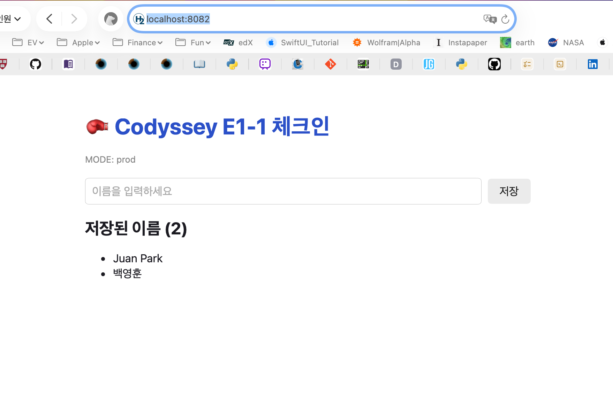
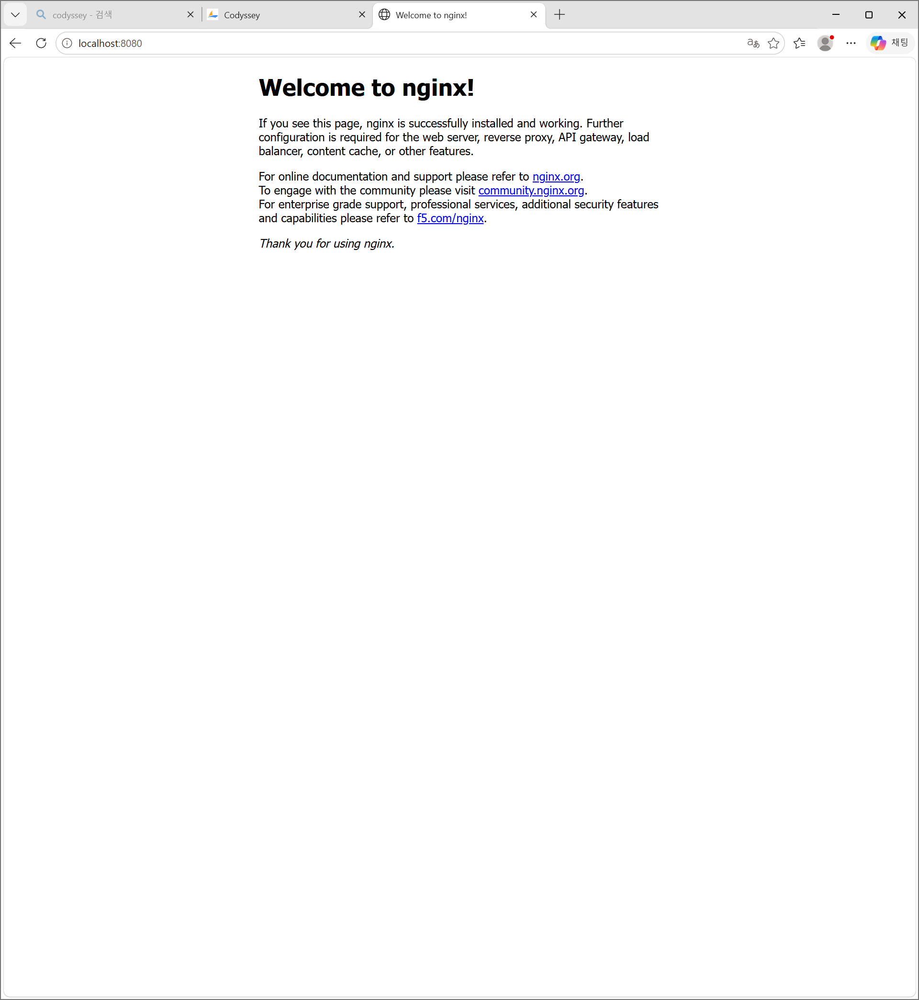
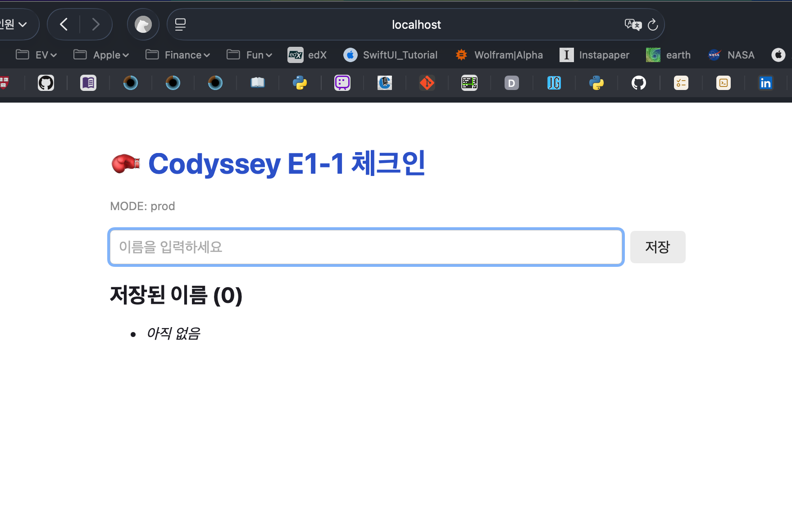
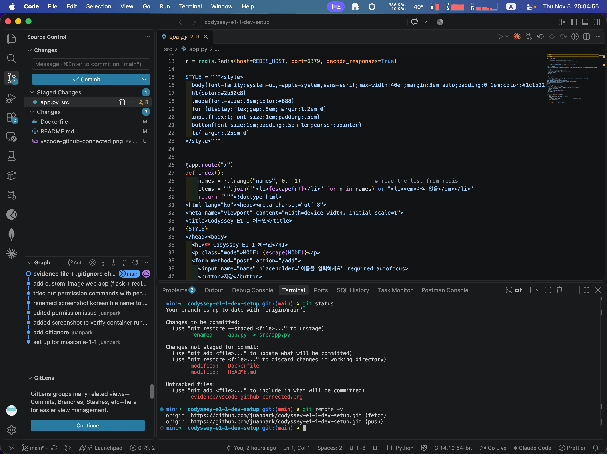
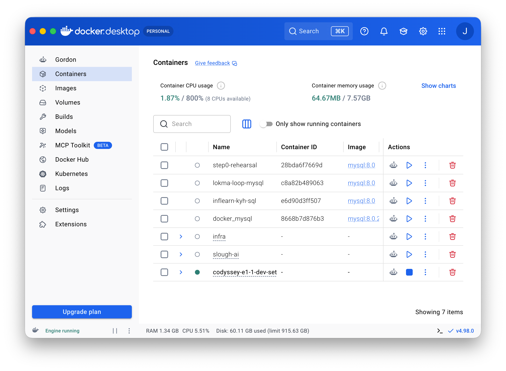

# Codyssey E1-1 — 개발 환경 구축 (Pre-course Dev Setup)

> 아무것도 세팅 안 된 랩 PC(Windows)에 WSL2·Docker·Git 개발 환경을 밑바닥부터 구축하고 각 단계의 명령·출력·근거를 기록한 미션.

- **제출 리포지토리**: [`codyssey-e1-1-dev-setup`](https://github.com/juanpark/codyssey-e1-1-dev-setup)
- **작성자**: 박정환 (juanpark : `juanpark@me.com`)

---

## 1. 미션 개요

이미 개인 맥에 설치/사용하는 개발환경을 재탕하기보다는 아무것도 세팅 안된 랩PC (Windows)에 **WSL2 + Ubuntu**로 리눅스 개발 환경을 세팅하고, 터미널 기본 조작·파일 권한·Docker(설치→운영→컨테이너→커스텀 이미지→포트/볼륨/바인드 마운트)·Git/GitHub 연동까지 **직접 실행하며 증거(명령 + 출력)를 남겼다.** 단순 설치 확인을 넘어 절대/상대경로·권한·포트 매핑·볼륨·Git vs GitHub 같은 개념을 **스스로 설명할 수 있는 수준**까지 정리하는 것을 목표로 했다.

핵심 Docker 요구사항(커스텀 이미지·멀티 컨테이너·포트·볼륨·환경변수)은 흩어진 예제 대신 **하나의 작은 웹앱("Codyssey 체크인")**으로 묶어, 요구사항들이 실제로 맞물려 돌아가는 모습을 보이도록 설계했다.

### 저장소 구조
```
codyssey-e1-1-dev-setup/
├── README.md               # 이 문서 (전체 수행 기록)
├── Dockerfile              # 커스텀 이미지 정의
├── docker-compose.yml      # 멀티 컨테이너 구성 (web + redis)
├── src/
│   └── app.py              # 웹 서버 소스 (Flask)
├── permission_demo/        # §4.2 권한 실습 (스크립트)
└── evidence/               # 접속·결과 스크린샷
```

---

## 2. 실행 환경

| 항목 | 값 |
|---|---|
| 호스트(설치) | Windows 11 캠퍼스 랩 PC + **WSL2** |
| 배포판 | **Ubuntu 26.04.1 LTS** |
| 커널 | `6.18.54.1-microsoft-standard-WSL2` |
| 셸 | bash(기본) → **zsh + Oh My Zsh** |
| Docker | **29.9.2** (Docker Desktop, WSL2 통합) |
| Git | **2.53.0** |

**두 환경에 대한 주석(재현성).** 설치·터미널·권한·Git 과정(§4.1–4.5, §4.10)은 **랩 PC의 WSL2**에서 수행했고, Docker 이미지 관련 데모(§4.6–4.9, Compose)는 동일 버전의 Docker(**macOS, Docker 29.9.2**)에서 수행했다. Docker 엔진·명령은 두 환경에서 동일하게 동작하므로 결과에 차이는 없다. 경로는 특정 PC에 종속되지 않도록 상대경로와 `~`로 표기했다 (§3-① 재현성 원칙 참고).

---

## 3. 핵심 개념 설명 (설명 루브릭 6)

### ① 절대경로 vs 상대경로
- **절대경로**: 루트 `/`부터 시작하는 전체 주소 → 실행 위치와 무관하게 같은 곳.  
   예) `/usr/local/bin/docker`, `~/codyssey/codyssey-e1-1-dev-setup/README.md`
- **상대경로**: **현재 작업 디렉토리(pwd)** 기준 → `cd`로 위치가 바뀌면 의미도 바뀜.   
  예) `./app.py`, `../evidence/shot.png`
- 기호: `.`(현재) · `..`(상위) · `~`(홈) · `/`(루트)
- **재현성과의 연결**: PC 종속 절대경로(`/Volumes/...`, `C:\Users\...`)를 그대로 쓰면 다른 PC/사용자가 참고할 때 문제가 생길 수 있다. 그래서 설정·문서에는 상대경로나 `~`를 쓰고, 불가피하면 대체 방법을 함께 적는다.

### ② 파일 권한 (r/w/x, 755/644)
- **r**(4)=읽기 · **w**(2)=쓰기 · **x**(1)=실행. 세 자리 = **소유자 / 그룹 / 기타**.
- `755` = `rwxr-xr-x` (실행파일·디렉토리 기본), `644` = `rw-r--r--` (일반 파일 기본).
- **파일의 x** = 실행 권한. **디렉토리의 x** = 진입(`cd`)·통과 권한 → 디렉토리는 x가 없으면 들어갈 수 없다(§4.2에서 `chmod 000`으로 실증).

### ③ 기존 이미지로 커스텀 이미지 만들기
- 베이스 이미지(`FROM python:3.12-slim`) 위에 **필요한 라이브러리(`RUN pip install ...`)**와 **내 앱 코드(`COPY`)**를 얹어 `docker build -t 이름:tag .`로 **커스텀 이미지**를 만든다.
- 각 지시어는 레이어로 캐시되어 재빌드가 빠르다. 만든 이미지는 `docker images`로 확인하고 그 이미지로 컨테이너를 실행한다. (§4.6)

### ④ 포트 매핑이 필요한 이유
- 컨테이너는 **격리된 자체 네트워크**를 갖는다. 안에서 listen 중인 포트는 밖에서 바로 접근할 수 없다.
- `-p 호스트포트:컨테이너포트`로 호스트 포트를 컨테이너 포트에 연결(발행)해야 브라우저로 접속할 수 있다. 예) `-p 8080:80` → 호스트 8080 → 컨테이너 80. 매핑이 없으면 서버는 돌아도 `connection refused`. (§4.7)

### ⑤ Docker 볼륨 (데이터 영속)
- 컨테이너는 삭제되면 내부 데이터도 사라진다. 유지돼야 하는 데이터는 **named volume**에 둬 컨테이너 밖(호스트)에 보관한다.
- Compose에 볼륨을 **선언**하면 `up`이 자동 생성한다. `docker compose down`은 볼륨을 **남겨** 데이터가 유지되고, `down -v`는 볼륨까지 지워 데이터가 사라진다 → 이 대조로 영속성이 볼륨 덕분임을 보여준다. (§4.9)
- **바인드 마운트**(§4.8)는 내가 지정한 실제 호스트 경로를 마운트해 양쪽이 같은 파일이 되는 방식(직접 보고 수정 가능). named volume은 Docker가 직접 관리한다.

### ⑥ Git vs GitHub
- **Git** = 내 컴퓨터(로컬)에서 사용하는 **버전관리 도구**(commit/branch/history/merge, 오프라인 가능).
- **GitHub** = git 레포(저장소)를 올려 공유·협업하는 **원격 호스팅 서비스**(PR/이슈/CI; GitLab·Bitbucket 등 대안도 있음).
- 관계: 로컬 저장소 ↔ GitHub 원격을 `push`/`pull`/`clone`으로 동기화하며, `git remote`가 둘을 연결한다. git은 GitHub 없이도 쓸 수 있고, GitHub은 git을 기반으로 동작한다. (§4.10)

---

## 4. 실습 기록 (명령 + 출력)

> 모든 비밀값(토큰/비밀번호/개인키)은 기록·캡처에서 제외하거나 마스킹했다 (§8 참고).

### 4.1 터미널 기본 조작
```text
$ pwd
/home/juanpark802617/codyssey/codyssey-e1-1-dev-setup
$ ls -la
$ touch demo.txt                                     # 빈 파일 생성
$ echo "become a linux cli (terminal) master!" > demo.txt
dquote>                                              # zsh: "..." 안의 !가 확장되며 멈춤
$ echo 'become a linux cli (terminal) master!' > demo.txt   # 작은따옴표(리터럴)로 해결
$ cat demo.txt
become a linux cli (terminal) master!
$ cp demo.txt demo_copy.txt                          # 복사
$ mv demo_copy.txt demo_renamed.txt                  # 이름변경
$ ls -la                                             # demo.txt + demo_renamed.txt
$ rm demo.txt demo_renamed.txt                       # 삭제(정리)
```
- `pwd/ls/touch/echo>/cat/cp/mv/rm` 기본 조작 확인. 데모 파일은 `rm`으로 정리.
- 실제로 겪은 것: `"..."`는 `!`를 확장(zsh)해 `dquote>`에서 멈췄고, `'...'`(리터럴)로 해결.

### 4.2 파일 / 디렉토리 권한 (변경 전/후)
```text
# 디렉토리의 x 비트
$ mkdir -p permission_demo ; ls -la          # drwxr-xr-x (755)
$ chmod 000 permission_demo
$ ls -la permission_demo                     # ls: cannot open directory '...': Permission denied
$ sudo ls -la permission_demo                # d--------- (000) 확인
$ chmod 755 permission_demo                  # drwxr-xr-x 복구

# 스크립트의 x 비트 (permission_demo/ 안에서)
$ cd permission_demo
$ ls -la permission_demo.sh                  # -rw-r--r-- (644, no x)
$ ./permission_demo.sh                       # → permission denied (x 없음)
$ chmod 755 permission_demo.sh ; ls -la      # -rwxr-xr-x (755)
$ ./permission_demo.sh                       # → You have permission to see this script! ✅
```
- 파일(스크립트)과 디렉토리 모두 권한 변경 전/후를 실증. 디렉토리는 x(755)가 없으면 목록·진입조차 거부됨(개념 ②).
- 실행 중 shebang 경로 오타를 만나 수정함 → §6 트러블슈팅 ③.

### 4.3 Docker 설치 및 점검
Docker Desktop(WSL2 통합)으로 설치. 최초 실행 시 소켓 권한에 막혔고, `docker` 그룹 추가로 해결했다.
```text
$ docker version
Client: Version 29.9.2 ...
  ... permission denied while trying to connect to the Docker daemon
      socket at unix:///var/run/docker.sock          # 서버 연결 거부
$ docker run hello-world                              # 같은 권한 오류
$ sudo docker run hello-world                         # Hello from Docker! → 데몬 자체는 정상
$ sudo usermod -aG docker $USER                       # 내 계정을 docker 그룹에 추가
$ exit                                                # 터미널 닫았다 다시 열기
$ docker run hello-world                              # Hello from Docker! ✅ (이제 sudo 없이)

$ docker --version
Docker version 29.9.2, build a82e528
$ docker info
 ...(생략)... Server Version: 29.9.2 · Storage Driver: overlayfs
 CPUs: 24 · Total Memory: 15.25GiB · Name: docker-desktop      # Server 섹션 정상
```
- `snap install docker`는 WSL에서 데몬/권한이 꼬이므로 사용하지 않았다.
- 소켓 권한의 원인·해결 정리 → §6 트러블슈팅 ②. (`chmod 666` 소켓은 금지 — docker 그룹은 사실상 root.)

### 4.4 Docker 운영 명령
```text
$ docker images                 # 로컬 이미지 목록 (hello-world:latest)
$ docker ps -a                  # 정지 포함 전체 (hello-world  Exited (0))
$ docker pull ubuntu            # 이미지 다운로드
$ docker ps                     # (ubuntu 안 보임) ← pull ≠ run
$ docker images                 # hello-world, nginx, ubuntu:latest
$ docker logs <nginx 컨테이너>   # 컨테이너 로그
$ docker stats                  # 실시간 CPU/MEM/NET/PIDS  (Ctrl-C로 빠져나옴)
```
- 관찰: `docker pull` 후 `docker ps`에는 안 나옴 → **이미지 ≠ 컨테이너**. `docker stats`에서 단일 프로세스 컨테이너는 `PIDS=1`.

### 4.5 컨테이너 실행 (ubuntu / exec / attach)
설치 검증(`hello-world`)은 §4.3에서 완료. 여기서는 ubuntu 컨테이너로 수명·`exec`·`attach`를 관찰했다.
```text
$ docker run -it --name ubuntu_demo ubuntu
root@ca4e...:/# whoami
root
root@ca4e...:/# uname -r
6.18.54.1-microsoft-standard-WSL2        # ← 호스트와 같은 커널 (컨테이너는 VM이 아님)
root@ca4e...:/# exit                     # 메인 프로세스(bash) 종료
$ docker ps                              # ubuntu_demo 없음 → 컨테이너 정지

$ docker run -d --name ubuntu_bg_demo ubuntu sleep infinity   # 백그라운드 유지
$ docker exec -it ubuntu_bg_demo bash    # 실행 중 컨테이너에 '새 프로세스' 추가
root@...:/# ps aux
  PID 1  sleep infinity                  # 메인 프로세스
  PID 7  bash                            # exec로 추가된 프로세스
root@...:/# exit
$ docker ps                              # ubuntu_bg_demo 여전히 Up (exec 나가도 유지)

$ docker attach ubuntu_bg_demo           # 메인 프로세스(PID 1)에 재연결
# ls 입력해도 출력 없음(메인은 sleep) ; Ctrl-C로도 멈추지 않음
$ docker ps                              # 여전히 Up (!)
```
- **핵심 개념**: 컨테이너 = 메인 프로세스(PID 1) 하나의 수명. `run -it`은 메인에 붙음(exit=정지), `exec`는 새 프로세스(exit해도 유지), `attach`는 메인에 재연결.
- **직접 관찰**: `sleep infinity`는 PID 1로서 핸들러 없는 신호(SIGINT)를 무시 → attach 중 Ctrl-C로 컨테이너가 멈추지 않음. 깔끔한 detach는 `Ctrl-P`→`Ctrl-Q`, 확실한 정지는 `docker stop` / `docker rm -f`.

### 4.6 커스텀 이미지 (직접 작성한 Dockerfile)

컨테이너로 만들 앱은 이름을 입력·저장·조회하는 작은 Flask 웹앱(`src/app.py`)이다. 이 소스를 베이스 이미지 위에 얹어 커스텀 이미지를 빌드했다. (소스는 `src/`, 설정은 루트의 `Dockerfile`·`docker-compose.yml`로 분리.)

**앱 코드 — `src/app.py` (Flask, CSS·일부 메타 생략):**

```python
from flask import Flask, request, redirect
from html import escape
import os
import redis

app = Flask(__name__)

# --- 설정을 환경변수로 주입 (설정과 코드 분리) ---
MODE = os.environ.get("APP_MODE", "dev")            # 화면에 표시할 모드
PORT = int(os.environ.get("PORT", "5000"))          # 서버 포트
REDIS_HOST = os.environ.get("REDIS_HOST", "redis")  # redis 서비스 '이름'으로 접속

r = redis.Redis(host=REDIS_HOST, port=6379, decode_responses=True)

STYLE = """<style> ...(CSS 생략)... </style>"""

@app.route("/")
def index():
    names = r.lrange("names", 0, -1)                # redis 리스트에서 이름 읽기
    items = "".join(f"<li>{escape(n)}</li>" for n in names) or "<li><em>아직 없음</em></li>"
    return f"""<!doctype html>
<html lang="ko"><head><meta charset="utf-8">{STYLE}</head><body>
  <h1>🥊 Codyssey E1-1 체크인</h1>
  <p class="mode">MODE: {escape(MODE)}</p>
  <form method="post" action="/add">
    <input name="name" placeholder="이름을 입력하세요" required autofocus>
    <button>저장</button>
  </form>
  <h2>저장된 이름 ({len(names)})</h2>
  <ul>{items}</ul>
</body></html>"""

@app.route("/add", methods=["POST"])
def add():
    name = request.form.get("name", "").strip()
    if name:
        r.rpush("names", name)                      # redis 리스트에 추가
    return redirect("/")

if __name__ == "__main__":
    app.run(host="0.0.0.0", port=PORT)
```

- **Flask**가 페이지를 띄우고 폼 입력을 받는다. 입력한 이름은 **redis**에 저장 → 별도 저장소가 필요하므로 **멀티 컨테이너**(§5.2)가 성립한다.
- `REDIS_HOST`/`APP_MODE`/`PORT`를 **환경변수**로 받아 설정과 코드를 분리(§5.4). redis에는 **서비스 이름 `redis`**로 접속 → Compose 네트워크에서 이름으로 통신한다.
- **env는 app.py에 하드코딩하지 않는다.** 코드의 `os.environ.get(이름, 기본값)`은 **기본값만** 갖고, 실제 값은 실행 시 `docker-compose.yml`의 `environment:`에서 주입된다(그래서 화면에 `MODE: prod`). 설정만 바꿔 동작을 바꿀 수 있고, 코드는 그대로다.
- 이름을 redis 리스트에 저장하므로, 재시작 후에도 유지하려면 **볼륨**이 필요하다(§4.9).
- 사용자 입력은 `escape()`로 이스케이프해 HTML 삽입을 방지(보안 습관).

**이미지 정의 — `Dockerfile` (직접 작성):**

```dockerfile
FROM python:3.12-slim          # 베이스 (경량 Debian + Python)
WORKDIR /app                   # 작업 디렉토리
RUN pip install --no-cache-dir flask redis   # [커스텀] 필요한 라이브러리
COPY src/app.py .              # [커스텀] 내 앱 코드 복사 (src/ → 이미지)
EXPOSE 5000                    # 서비스 포트 문서화
CMD ["python", "app.py"]       # 시작 시 실행할 명령
```

```text
$ docker compose build          # (= docker build -t codyssey-e1-1-web:1.0 .)
 ...(생략)...
 #7  [1/4] FROM docker.io/library/python:3.12-slim@sha256:b18b...
 #8  [2/4] WORKDIR /app                                   CACHED
 #9  [3/4] RUN pip install --no-cache-dir flask redis     CACHED
 #10 [4/4] COPY src/app.py .                              CACHED
 #10 exporting to image ... naming to ...codyssey-e1-1-web:1.0  done
 Image codyssey-e1-1-web:1.0  Built
$ docker images | grep codyssey                          # codyssey-e1-1-web:1.0  (약 231MB)
```

- **커스텀 포인트**는 `RUN`(라이브러리 설치)과 `COPY`(앱 코드) — 기존 `python:3.12-slim`에는 없던 내 요구사항을 레이어로 얹은 것. 이 이미지를 Compose로 실행한다(§5).



### 4.7 포트 매핑 (브라우저 접속)
격리된 컨테이너 네트워크를 호스트 포트에 연결해야 브라우저로 접속된다(개념 ④).

**(1) 공식 nginx 이미지 — `-p 8080:80`**
```text
$ docker run -d -p 8080:80 nginx
$ curl http://localhost:8080       # nginx welcome HTML 응답 ✅
```


**(2) 커스텀 앱 — `-p 8082:5000`** (Compose, §5)
→ 위 §4.6 스크린샷(주소창 `localhost:8082` + 포트). 호스트 포트(8082)와 컨테이너 포트(5000)가 다르게 매핑된 것을 주소창에서 확인할 수 있다.

### 4.8 바인드 마운트 (호스트 ↔ 컨테이너 양방향 반영)
```text
# 컨테이너 → 호스트
$ docker run --rm -v "$(pwd)/bindtest:/data" alpine sh -c 'echo "from the container" > /data/hello.txt'
$ cat bindtest/hello.txt
from the container

# 호스트 → 컨테이너
$ echo "from the host" > bindtest/reply.txt
$ docker run --rm -v "$(pwd)/bindtest:/data" alpine cat /data/reply.txt
from the host
```
- `-v 호스트경로:컨테이너경로` → 양쪽이 **같은 파일**이라 수정이 실시간 양방향으로 반영된다.
- `-v` 왼쪽이 **경로**(`./`,`/`)면 바인드 마운트, **이름**이면 named volume(§4.9). `--rm`은 종료 시 컨테이너 자동 삭제.

### 4.9 볼륨 영속성 (named volume)
커스텀 앱은 입력한 이름을 redis에 저장하고, redis는 데이터를 named volume(`codyssey_data`)에 AOF로 기록한다.

```text
# ── 유지: 컨테이너만 제거, 볼륨 보존 ──
$ docker compose down            # web/redis/network 제거 (named volume은 남김)
$ docker compose up -d           # 재실행 → 같은 볼륨 re-mount
# → 브라우저: 저장한 이름 그대로 유지 ✅

# ── 소실: 볼륨까지 제거 ──
$ docker compose down -v         # -v = named volume까지 제거
  ✔ Volume codyssey-e1-1-dev-setup_codyssey_data  Removed
$ docker volume ls | grep codyssey   # (없음)
$ docker compose up -d           # 빈 볼륨 새로 생성
# → 브라우저: "저장된 이름 (0)" 비어 있음
```
- `down`(유지) vs `down -v`(소실)의 **대조**로, 영속성이 **볼륨** 덕분임을 입증.



### 4.10 Git & GitHub 연동
```text
$ git config --global user.name "juanpark"
$ git config --global user.email "juanpark@me.com"     # GitHub 프로필 연결 이메일
$ git config --global init.defaultBranch main
$ git config --global --list
user.name=juanpark
user.email=juanpark@me.com
init.defaultbranch=main

$ git init                                             # 로컬 저장소 (main 브랜치)
$ git add . ; git commit -m "set up for mission e-1-1"
[main (root-commit) 2643ec6] set up for mission e-1-1
$ git log                                              # Author: juanpark <juanpark@me.com> ✅

$ gh repo create codyssey-e1-1-dev-setup --public
✓ Created repository juanpark/codyssey-e1-1-dev-setup on GitHub
$ git remote add origin git@github.com:juanpark/codyssey-e1-1-dev-setup.git
$ git push -u origin main
 * [new branch]  main -> main                          # 로컬 → GitHub 동기화
```
- 로컬 버전관리(git)와 원격 호스팅(GitHub)을 연결·동기화(개념 ⑥). 커밋 Author 이메일을 GitHub 프로필 이메일로 맞춰 커밋이 프로필에 연결되도록 했다.
- `.gitignore`로 비밀값·빌드 산출물(`.env`, `*.key`, `__pycache__/` 등)을 추적 제외.
- **VSCode 연동:** 저장소를 VSCode로 열어 Source Control 패널·커밋 그래프로 로컬 커밋 이력을, 통합 터미널의 `git remote -v`로 **GitHub 원격(origin) 연동**을 확인했다. (랩 PC 셋업은 SSH 키로 origin 연결, 이 Mac 클론은 `gh` HTTPS 인증 — **동일 GitHub 저장소**.)



---

## 5. Docker Compose & 보너스 (§5)

긴 `docker run ...`을 **문서화된 설정**으로 바꾸고, 여러 컨테이너를 한 번에 관리하기 위해 Compose를 사용했다.

```yaml
services:
  web:
    build: .                      # Dockerfile로 빌드
    image: codyssey-e1-1-web:1.0
    ports:
      - "8082:5000"               # 포트 매핑 (호스트:컨테이너)
    environment:
      APP_MODE: prod              # 환경변수 → 화면에 표시
      PORT: "5000"
      REDIS_HOST: redis           # redis 서비스를 '이름'으로 참조
    depends_on:
      - redis
  redis:
    image: redis:7-alpine
    command: ["redis-server", "--appendonly", "yes"]   # AOF 영속
    volumes:
      - codyssey_data:/data       # named volume
volumes:
  codyssey_data:
```

```text
$ docker compose up -d           # 전체 기동
$ docker compose ps              # web Up 0.0.0.0:8082->5000 | redis Up 6379
$ docker compose logs            # 두 서비스 로그
$ docker compose down            # 정리 (볼륨 유지)
```



| 보너스 요구 | 충족 |
|---|---|
| Compose 단일/멀티 컨테이너 | `web` + `redis` 두 서비스 |
| 서비스 간 통신 | web이 `REDIS_HOST=redis`로 redis를 **서비스 이름**으로 접근(입력한 이름이 저장됨 = 통신 증명) |
| up/down/ps/logs | 위 명령으로 운영 |
| 환경변수 | `APP_MODE`/`PORT`/`REDIS_HOST` (화면의 `MODE: prod`가 env 반영) |
| SSH 키 | `gh auth login` 시 ed25519 키 생성·GitHub 업로드 완료 |

---

## 6. 트러블슈팅

> 문제 → 원인 → 확인 → 해결

1. **WSL 배포 미설치** — 재부팅 후 `wsl` 실행 시 "설치된 배포가 없습니다". 원인: 1차 `wsl --install`은 WSL 기능/커널만 설치(재부팅 후 활성화)하고 배포는 미설치. 해결: 재부팅 후 `wsl --install` 재실행 → Ubuntu 설치·계정 생성.
2. **Docker 소켓 권한 거부** — `docker run` 시 `permission denied ... /var/run/docker.sock`. 원인: 사용자가 `docker` 그룹에 없음. 확인: `sudo docker run hello-world`는 성공(데몬 정상). 해결: `sudo usermod -aG docker $USER` + 터미널 재시작. (`chmod 666` 소켓은 금지 — docker 그룹은 사실상 root 권한.)
3. **스크립트 shebang 경로 오타** — `./permission_demo.sh` 실행 시 `bad interpreter: /sh/zsh`. 원인: shebang이 잘못된 경로(`#!/sh/zsh`). 확인: `echo $SHELL` = `/usr/bin/zsh`. 해결: `#!/usr/bin/zsh`로 수정. (이식성엔 `#!/usr/bin/env bash` 권장.)
4. **gh 브라우저 자동 실행 실패** — `gh auth login` 웹 인증에서 `exec: "...wslview": not found`. 원인: WSL에 브라우저 런처(wslview) 미설치. 해결: 표시된 URL을 Windows 브라우저에 수동 입력. (근본 해결: `sudo apt install wslu`.)
5. **포트 충돌 (호스트 포트 선점)** — 증상: `docker run -p ...` 또는 `docker compose up`이 `bind: address already in use`로 실패. 원인: 매핑하려는 호스트 포트(예: 8082)를 다른 프로세스가 이미 점유. 확인 → 해제:
```text
# 1) 포트를 점유한 프로세스(PID) 확인
$ lsof -i :8082                  # macOS / Linux
COMMAND     PID      USER  ...  NAME
com.docker 1234  juanpark  ...  TCP *:8082 (LISTEN)   # ← 점유 프로세스 + PID(1234)
$ ss -ltnp | grep :8082          # Linux (listen 소켓 + PID)
> netstat -ano | findstr :8082   # Windows / WSL 호스트 측 (마지막 열 = PID)

# 2) 해제 — 점유 프로세스 종료
$ kill <PID>                     # 안 되면 강제: kill -9 <PID>
> taskkill /PID <PID> /F         # Windows

# 또는 프로세스를 죽이지 않고 매핑 호스트 포트를 변경
$ docker run -p 8083:5000 ...    # compose면 ports의 "8082:5000" → "8083:5000"
```
확인: 다시 `lsof -i :8082`가 비면 해제 완료 → `docker compose up -d` 재시도.

---

## 7. 재현 방법

```text
$ git clone https://github.com/juanpark/codyssey-e1-1-dev-setup.git
$ cd codyssey-e1-1-dev-setup
$ docker compose up -d
# 브라우저에서 http://localhost:8082 접속 → 이름 입력/저장 동작 확인
$ docker compose down            # 정리 (데이터 유지)
```
- 필요한 것: Docker(Compose 포함). 앱 라이브러리는 이미지 빌드 시 설치되므로 호스트에 별도 설치 불필요.
- 경로는 상대경로/`~`로 표기해 특정 PC에 종속되지 않도록 했다.

---

## 8. 보안 / 마스킹 노트

- 개인 SSH 키는 어떤 경로로도 공유·전송하지 않았다(공개키만 GitHub 업로드).
- gh 토큰·one-time code·비밀번호는 기록/캡처에서 제외하거나 마스킹.
- `.gitignore`로 `.env`, `*.key`, `*.pem`, `*_token*` 등 비밀값 패턴을 추적에서 제외.
